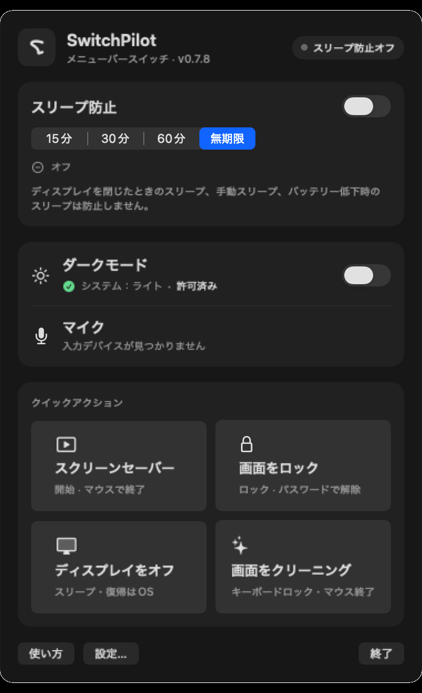
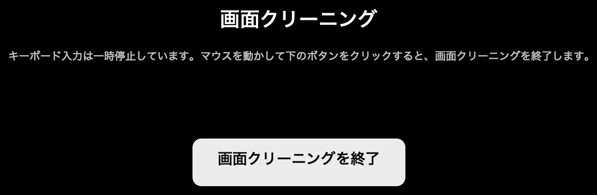

#  SwitchPilot

[English](README.md) · [简体中文](README.zh-CN.md) · [繁體中文](README.zh-Hant.md) · [設計原則](docs/en/CORE.md) · [アーキテクチャ](docs/en/ARCHITECTURE.md) · [テスト](docs/en/TESTING.md) · [ロードマップ](docs/en/ROADMAP.md)

[](https://github.com/PilotFoundry/switchpilot/actions/workflows/ci.yml)

バージョン 0.7.1 · PilotFoundry が維持する、信頼できるいくつかのシステム操作に絞ったオープンソースでプライバシー重視の小さな macOS メニューバーユーティリティです。

> このリポジトリは、初期の調査や受け入れ検証の記録を含む完全な開発履歴を保持しています。アプリのソースコードと現在の英語ドキュメントはルートにあり、過去の資料は `artifacts/`、`evidence/`、`tooling/` などのディレクトリにあります。詳しくは [docs/RESEARCH.md](docs/RESEARCH.md) をご覧ください。

<p align="center">
  
  
</p>

## 機能

| 機能 | 動作 |
|---|---|
| スリープ防止 | 15/30/60 分または無期限。残り時間を表示 |
| ダークモード | System Events を介してシステムの外観を読み取り、切り替え |
| スクリーンセーバー | システムのスクリーンセーバーを起動 |
| 画面をロック | システムのロックショートカットを送信（オートメーションとアクセシビリティの権限が必要） |
| ディスプレイをオフ | 公開されている `pmset displaysleepnow` コマンドを使用 |
| マイクのミュート | デフォルトの入力デバイスの対応状況に応じてミュート。非対応時は状態を偽装しない |
| 画面クリーニング | 全画面オーバーレイ、キーボード入力の一時停止、マウスで終了、最後の手段となる非表示のタイマー |
| ログイン時に起動 | 任意で有効化できる `SMAppService` ログイン項目。設定で管理 |
| グローバルショートカット | 固定の `⌃⌥⌘K` / `⌃⌥⌘S` ショートカット。初期状態では無効 |
| ローカライズ | 英語、簡体字中国語、繁体字中国語、日本語。初期状態ではシステム言語に従う。アプリ内で言語を上書きでき、再起動で反映 |

<p align="center">
  
</p>

## このプロジェクトがある理由

オリジナルの One Switch は多機能ですが、日常的に使うのはごく少数のシステム状態だけです。SwitchPilot はあえて提供する機能を絞っています：

- **少数で確実**：30 個のスイッチが並ぶダッシュボードではなく、本当に必要な操作だけを確実に。
- **非公開 API なし、特権ヘルパーなし、バックグラウンド自動化なし。**
- **テレメトリーなし、ネットワークアクセスなし。**
- **権限について正直に**：オートメーションやアクセシビリティの権限がない場合、その操作は利用できず、何も知らせずに成功したように表示されることもありません。
- **状態が見える操作**：マイクのミュートと画面クリーニングは状態を表示し、画面クリーニングではキーボードをロックしたままマウスで終了できます。

出力音量、低電力モード、True Tone、デスクトップアイコンの非表示、Night Shift、Wi-Fi／Bluetooth の制御、シーン自動化は意図的に対象外としています。採用基準については [docs/en/CORE.md](docs/en/CORE.md)、現在の状況については [docs/en/ROADMAP.md](docs/en/ROADMAP.md) をご覧ください。

## リポジトリのアイデンティティ

README のロゴ、アプリアイコン、`assets/social-preview.png` は、いずれも同じ SwitchPilot のマークを使用しています。ソーシャルプレビュー画像は、リポジトリの所有者が GitHub の設定でアップロードするためのものです。アプリアイコンが引き続き基準となります。

## 言語

SwitchPilot は 4 つの UI ローカライズを提供しています：

- 英語（English）
- 簡体字中国語（简体中文）
- 繁体字中国語（繁體中文）
- 日本語

初期状態では**システムに従う**が選択されています。設定 → 言語で利用可能な言語のいずれかを明示的に選択できます。変更後は、AppKit／SwiftUI と権限確認ダイアログのローカライズを確実に再読み込みするため、アプリを開き直すよう求められます。

## ダウンロード（ad-hoc プレビュー）

[最新リリース](https://github.com/PilotFoundry/switchpilot/releases/latest) では、対応するタグのソースからビルドした universal（Apple Silicon + Intel）版 macOS アプリを配布しています。現在このプロジェクトには Developer ID 証明書がないため、**ad-hoc 署名・未公証** のビルドです。

- 要件：macOS 14 以降
- ファイル：`SwitchPilot-0.7.1-macos-universal-adhoc.zip`
- ダウンロードして展開し、`SwitchPilot.app` を `/Applications` に移動
- 初回起動時に macOS にブロックされる場合：アプリを右クリック → **開く**
- ターミナルを使う場合は、このアプリだけに限定して実行：
  `xattr -dr com.apple.quarantine /Applications/SwitchPilot.app`
- Gatekeeper をシステム全体で無効にしないでください

zip は `./scripts/build-release` でビルドされ、SHA-256 ファイルもリリースに添付されます（`SwitchPilot-0.7.1-macos-universal-adhoc.zip.sha256`）。これはダウンロード用の便宜的なビルドであり、Developer ID／公証済みの配布物ではありません。完全に信頼したい場合は、ソースから自分でビルドして署名してください。

## 動作環境

- macOS 14 以降（主に macOS 27 で開発・検証）
- Swift 6.x
- Apple の Command Line Tools または Xcode
- ディスプレイを備えた Mac（画面クリーニングモードでは、アクセシビリティの権限も必要です）

外部の Swift パッケージは必要ありません。

## ビルドと実行

```sh
git clone https://github.com/PilotFoundry/switchpilot.git
cd switchpilot

swift build --package-path app/SwitchPilot --build-system native
./scripts/build-app
./scripts/install-app
open ~/Applications/SwitchPilot.app
```

`scripts/build-app` は `.app` を組み立て、**デフォルトで ad-hoc 署名**を行います。ad-hoc 署名ではコード署名 ID がバイナリを変更するたびに変わるため、再ビルド後に macOS から改めて権限を求められることがあります。ローカルで安定した署名 ID を使いたい場合は、自分で管理している開発用証明書で署名してください：

```sh
SWITCHPILOT_SIGN_IDENTITY="Apple Development: Your Name (TEAMID)" ./scripts/build-app
```

証明書、署名用の素材、Gatekeeper の回避策は絶対にコミットしないでください。このアプリは公証されておらず、ローカルでビルドして実行することを前提としています。配布用のバイナリではありません。

### Make ターゲット

```sh
make build   # Swift パッケージをビルド
make app     # .app を組み立て
make smoke   # TCC を必要としない CI 向けビルド＋コントラスト検査
make install # ~/Applications にコピー
```

## 権限

SwitchPilot が権限を要求するのは、その権限を必要とする機能を実際に使用したときだけです。

| 権限 | 用途 | 備考 |
|---|---|---|
| オートメーション → System Events | ダークモードと画面をロックするショートカット | これらの操作に必要 |
| アクセシビリティ | 画面のロックと画面クリーニング | 画面クリーニングでは、キーボードイベントを一時停止するために使用 |
| ログイン項目の承認 | ログイン時に起動 | `SMAppService` とシステム設定で管理 |

アプリが**自ら権限を付与したり、TCC データベースを変更したり、SIP を無効化したり、`tccutil reset` を自動実行したりすることはありません**。上級者向けのリセットパネルは、ユーザーが明示的に確認した場合にのみコマンドをコピーします。権限を取り消す場合は、システム設定で操作してください。

## 画面クリーニングの安全性

画面クリーニングは、単なる黒いオーバーレイではありません。セッションのイベントタップを通じてキーボードイベントを実際に一時停止し、その間もマウスは使用できます。終了するには、画面に表示される**画面クリーニングを終了**ボタンを使用してください。設計上、キーボードによる終了操作はありません。

マウスやアプリの状態に問題が生じた場合に備え、最後の手段として非表示の 5 分タイマーがセッションを解放します。通常の使用では、このタイマーはカウントダウンとして表示されません。マウスを使用できない人がディスプレイを清掃している間は、このモードを実行しないでください。クリーニング用オーバーレイはローカル UI のみで、システム設定を変更しません。

## プライバシー

- アクセス解析、テレメトリー、クラッシュレポートのアップロード、ネットワークリクエスト、リモート設定はありません。
- 設定は、ローカルの Mac にある `UserDefaults` に保存されます。
- 診断情報は、ユーザーが明示的に実行した場合に限り `/tmp` に書き込まれます。
- マイクの音声は録音しません。読み書きするのはミュート属性のみです。
- TCC データベース、Keychain、Cookie、無関係なファイルにはアクセスしません。

## ステータスとテスト

これは初期段階のオープンソースプロジェクトです。権限やハードウェアに依存する一部のフローでは、手動での受け入れ確認が必要です。自動テストがないことは、そのフローが検証済みであることを意味しません。CI ワークフローは GitHub の macOS ランナー上でアプリをビルドし、スモークチェックを実行しますが、TCC および TCC 関連の権限は意図的に要求しません。手動テストのマトリクスについては [docs/en/TESTING.md](docs/en/TESTING.md) をご覧ください。

## リポジトリ構成

```text
app/SwitchPilot/             Swift パッケージ、アプリ、チェック用実行ファイル
  Sources/SwitchPilot/       AppKit + SwiftUI のメニューバーアプリ
  Sources/SwitchPilotCore/   UI 以外のシステム連携
  Sources/SwitchPilotChecks/ コア動作を対象とした非 XCTest チェック
  Resources/                 アプリアイコンのソース
docs/                        設計原則、アーキテクチャ、テスト、ロードマップ
docs/images/                 スクリーンショット
scripts/                     ビルド、インストール、スモーク、コントラスト検査
```

## コントリビューション

Issue やプルリクエストを歓迎します。まず [CONTRIBUTING.md](CONTRIBUTING.md) と[行動規範](CODE_OF_CONDUCT.md)をお読みください。製品スコープの変更は CORE の採用基準を満たす必要があります。小さな修正であれば、機能についての議論は不要です。

セキュリティに関する報告は、GitHub の非公開[セキュリティアドバイザリ](https://github.com/PilotFoundry/switchpilot/security/advisories)をご利用ください。詳しくは [SECURITY.md](SECURITY.md) をご覧ください。

## ライセンス

MIT © 2026 pengxianghao。詳しくは [LICENSE](LICENSE) をご覧ください。

SwitchPilot は独立したプロジェクトです。One Switch はそれぞれの権利者の製品です。このリポジトリには、One Switch のコード、アセット、配布用バイナリは含まれていません。
