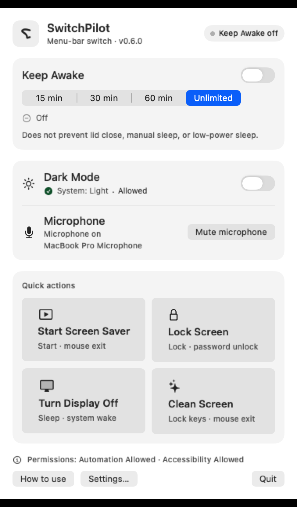
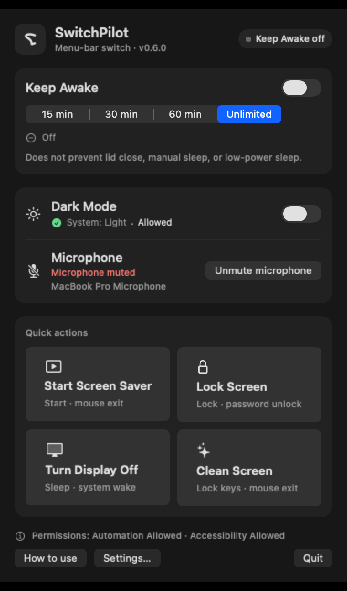
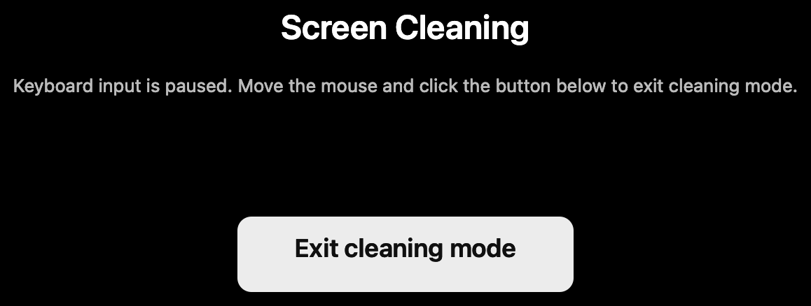

#  SwitchPilot

[中文说明](README.zh-CN.md) · [Design principles](docs/en/CORE.md) · [Architecture](docs/en/ARCHITECTURE.md) · [Testing](docs/en/TESTING.md) · [Roadmap](docs/en/ROADMAP.md)

[](https://github.com/pengxianghao21/switchpilot/actions/workflows/ci.yml)

Version 0.6.0 · A small, privacy-first macOS menu bar utility for a few reliable system
controls. SwitchPilot is a personal-use project, not a full One Switch clone
and not affiliated with One Switch.

> This repository preserves the complete development history, including its
> original research and acceptance notes. The app source and current English
> documentation live at the root; historical material is under `artifacts/`,
> `evidence/`, `tooling/` and related paths. See [docs/RESEARCH.md](docs/RESEARCH.md).

<p align="center">
  
  
</p>

## Features

| Feature | Behavior |
|---|---|
| Keep awake | 15/30/60 minutes or unlimited, with a visible remaining-time state |
| Dark mode | Reads and toggles the system appearance through System Events |
| Screen saver | Starts the system screen saver |
| Lock screen | Sends the system lock shortcut, gated by Automation + Accessibility |
| Display sleep | Uses the public `pmset displaysleepnow` command |
| Microphone mute | Capability-aware mute for the default input device; no fake state when unsupported |
| Screen cleaning | Full-screen overlay, keyboard input suspended, mouse exit, hidden last-resort timeout |
| Login at start | Optional `SMAppService` login item, controlled in Settings |
| Global hotkeys | Fixed `⌃⌥⌘K` / `⌃⌥⌘S` shortcuts, disabled by default |
| Localization | English UI on English systems; Chinese source/fallback; localized permission prompts and screenshots |

<p align="center">
  
</p>

## Why this project exists

Original One Switch is feature-rich, but most day-to-day use comes down to a
handful of system states. SwitchPilot deliberately keeps a small surface:

- **Few and reliable** instead of a 30-toggle dashboard.
- **No private APIs, no privileged helper, no background automation.**
- **No telemetry and no network access.**
- **Honest permissions**: missing Automation/Accessibility permission means the
  affected action is unavailable, not silently reported as successful.
- **Status-visible actions**: microphone mute and screen cleaning show their
  state, and screen cleaning keeps a mouse exit while the keyboard is locked.

Output volume, low battery mode, True Tone, desktop-icon hiding, Night Shift,
Wi-Fi/Bluetooth controls and scene automation are intentionally out of scope.
See [docs/en/CORE.md](docs/en/CORE.md) for the admission rules and
[docs/en/ROADMAP.md](docs/en/ROADMAP.md) for the current status.

## Repository identity

The README mark, app icon and `assets/social-preview.png` use the same SwitchPilot mark. The social-preview image is provided for the repository owner to upload in GitHub settings; the app icon remains the source of truth.

## Requirements

- macOS 14 or later (developed and tested primarily on macOS 27)
- Swift 6.x
- Apple Command Line Tools or Xcode
- A Mac with a display; the screen-cleaning mode also needs Accessibility
  permission

No external Swift packages are required.

## Build and run

```sh
git clone https://github.com/pengxianghao21/switchpilot.git
cd switchpilot

swift build --package-path app/SwitchPilot --build-system native
./scripts/build-app
./scripts/install-app
open ~/Applications/SwitchPilot.app
```

`scripts/build-app` assembles the `.app` and signs it **ad-hoc by default**.
Ad-hoc code identity changes when the binary changes, so macOS may ask for
permissions again after a rebuild. For a stable local identity, sign with a
development certificate you control:

```sh
SWITCHPILOT_SIGN_IDENTITY="Apple Development: Your Name (TEAMID)" ./scripts/build-app
```

Never commit certificates, signing material or a Gatekeeper workaround. The app
is not notarized and is intended to be built and run locally; it is not a
distributed binary.

### Make targets

```sh
make build   # Swift package build
make app     # assemble the .app
make smoke   # CI-safe build + contrast check (no TCC)
make install # copy into ~/Applications
```

## Permissions

SwitchPilot asks for permissions only when you use a feature that needs them.

| Permission | Used for | Notes |
|---|---|---|
| Automation → System Events | Dark mode and lock-screen shortcut | Required for those actions |
| Accessibility | Lock screen and screen cleaning | Screen cleaning uses it to suspend keyboard events |
| Login item approval | Launch at login | Managed through `SMAppService` and System Settings |

The app does **not** grant itself permissions, modify the TCC database, disable
SIP, or run `tccutil reset` automatically. The advanced reset panel only copies
commands after an explicit confirmation. Revoke permissions in System Settings.

## Screen cleaning safety

Screen cleaning is not just a black overlay: it actually suspends keyboard
events through a session event tap, while the mouse remains usable. Use the
visible **Exit cleaning mode** button to leave. There is no keyboard exit, by
design.

A hidden five-minute last-resort timer releases the session if the mouse or app
state fails. This timer is not shown as a countdown in normal use. Do not run
the mode while the display is being serviced by someone who cannot use a mouse.
The cleaning overlay is local UI only and does not modify system settings.

## Privacy

- No analytics, telemetry, crash upload, network requests, or remote config.
- Settings are stored in `UserDefaults` on the local Mac.
- Diagnostics are written to `/tmp` only when you explicitly invoke them.
- No microphone audio is recorded; only the mute property is read/written.
- No TCC database, Keychain, cookies, or unrelated files are accessed.

## Status and testing

This is an early, personal-use project. Some permission and hardware-dependent
flows require manual acceptance; absence of an automated test does not mean a
flow is verified. The CI workflow builds the app and runs a smoke check on a
GitHub macOS runner; it deliberately does not request TCC/TCC-adjacent
permissions. See [docs/en/TESTING.md](docs/en/TESTING.md) for the manual matrix.

## Repository layout

```text
app/SwitchPilot/             Swift package, app and checks executable
  Sources/SwitchPilot/       AppKit + SwiftUI menu bar app
  Sources/SwitchPilotCore/   Non-UI system integrations
  Sources/SwitchPilotChecks/ Non-XCTest checks for core behavior
  Resources/                 App icon source
docs/                        Design principles, architecture, testing, roadmap
docs/images/                 Screenshots
scripts/                     Build, install, smoke and contrast checks
```

## Contributing

Issues and pull requests are welcome. Read
[CONTRIBUTING.md](CONTRIBUTING.md) and the
[Code of Conduct](CODE_OF_CONDUCT.md) first. Product-scope changes must pass the
CORE admission rules; small fixes do not need a feature debate.

For security reports, use GitHub's private
[security advisory](https://github.com/pengxianghao21/switchpilot/security/advisories)
flow; see [SECURITY.md](SECURITY.md).

## License

MIT © 2026 pengxianghao. See [LICENSE](LICENSE).

SwitchPilot is an independent project. One Switch is a product of its
respective owner; this repository contains no One Switch code, assets or
distribution binaries.
