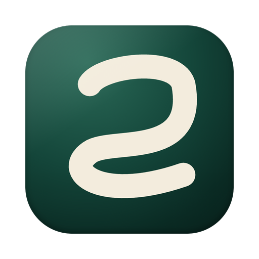
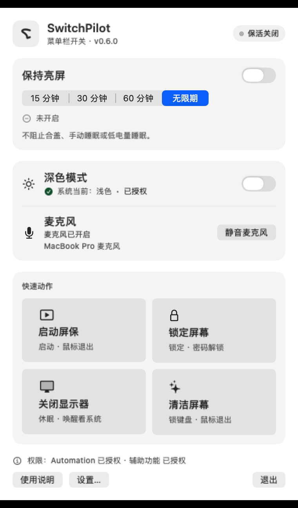
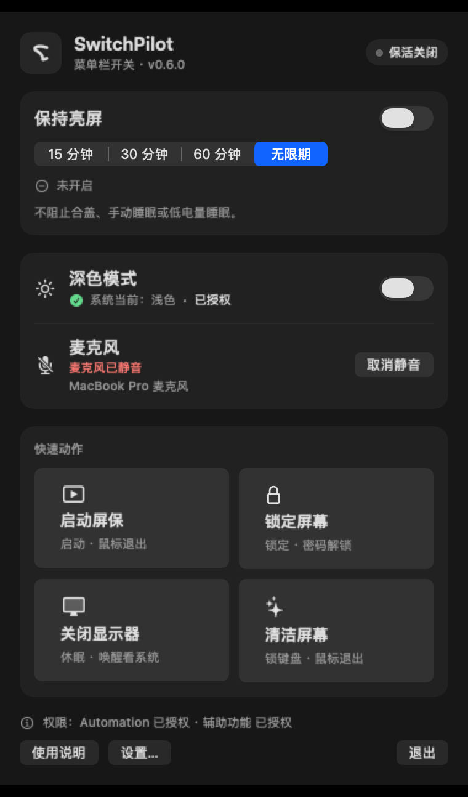

#  SwitchPilot

[English](README.md) · [核心理念](docs/en/CORE.md) · [架构](docs/en/ARCHITECTURE.md) · [测试](docs/en/TESTING.md)

当前 0.6.0 · 一个小而克制的 macOS 菜单栏系统开关工具，个人自用项目，不是 One Switch 的全量复刻，也与 One Switch 无隶属关系。

<p align="center">
  
  
</p>

## 功能

- 保持亮屏：15/30/60 分钟或无限期，带回倒计时/剩余时间。
- 深色模式、启动屏保、锁定屏幕、关闭显示器。
- 麦克风静音：按默认输入设备能力显示和切换，不支持时诚实提示。
- 屏幕清洁：全屏遮罩，暂停键盘输入，鼠标点击退出；正常模式不显示倒计时，保留内部 5 分钟失效保护。
- 登录时启动（可选）、固定全局快捷键（默认关闭）、单实例。
- 无遥测、无网络、无私有 API、无后台自动化；不自动执行 `tccutil reset`。

明确不做：输出音量、低电量模式、原彩显示、隐藏桌面、Night Shift、Wi-Fi/蓝牙控制、场景自动化。取舍原因见 [docs/en/CORE.md](docs/en/CORE.md)。

## 仓库说明

本仓库保留完整开发历史，包括早期研究、失败实验和现场验收记录；当前应用与英文/系统语言文档位于根目录，历史资料见 `artifacts/`、`evidence/`、`tooling/` 等目录。One Switch 是其各自权利人的产品，SwitchPilot 与其无隶属关系。

## 构建

要求 macOS 14+、Swift 6.x、Command Line Tools 或 Xcode。

```sh
git clone https://github.com/pengxianghao21/switchpilot.git
cd switchpilot
swift build --package-path app/SwitchPilot --build-system native
./scripts/build-app
./scripts/install-app
open ~/Applications/SwitchPilot.app
```

默认使用 ad-hoc 签名，重建后代码身份会变化，macOS 可能重新询问权限。若要稳定本地签名：

```sh
SWITCHPILOT_SIGN_IDENTITY="Apple Development: Your Name (TEAMID)" ./scripts/build-app
```

不要提交证书、签名材料或应用包。项目未公证，不提供分发二进制，建议本地构建使用。

## 权限

- **Automation → System Events**：深色模式、锁屏快捷键。
- **辅助功能**：锁屏、屏幕清洁（键盘事件拦截）。
- **登录项批准**：登录时启动。

应用只在用户主动操作时申请对应权限；未授权时相关功能不可用并显示真实原因。高级权限重置仅在显式确认后复制命令，不自动执行。

## 屏幕清洁安全

屏幕清洁会真正暂停键盘输入，鼠标仍可用；点击屏幕上的“退出清洁模式”退出。正常模式不提供键盘退出，也不显示倒计时；内部 5 分钟失效保护仅用于异常兜底。不要在无人操作鼠标的场景下使用。

## 开发与测试

```sh
make smoke   # 构建 + .app 组装 + 对比度检查（不触发 TCC）
```

CI 只做构建和离屏静态/对比度检查，不申请 TCC 权限。TCC、真实锁屏/屏保/显示器休眠、登录项、麦克风真实写入、键盘拦截等仍需按 [docs/en/TESTING.md](docs/en/TESTING.md) 现场验证。

## 许可证

MIT © 2026 pengxianghao。详见 [LICENSE](LICENSE)。
