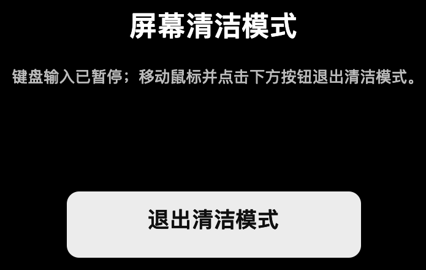

#  SwitchPilot

[English](README.md) · [繁體中文](README.zh-Hant.md) · [日本語](README.ja.md) · [文档](docs/README.md) · [核心理念](docs/en/CORE.md) · [架构](docs/en/ARCHITECTURE.md) · [测试](docs/en/TESTING.md) · [路线图](docs/en/ROADMAP.md)

[](https://github.com/PilotFoundry/switchpilot/actions/workflows/ci.yml)

版本 0.7.4 · 由 PilotFoundry 维护的开源、隐私优先 macOS 菜单栏工具，只保留少数可靠、低权限的系统控制。

> 本仓库保留完整开发历史，包括早期研究、失败实验和现场验收记录。应用源码与当前英文文档位于根目录；历史材料在 `artifacts/`、`evidence/`、`tooling/` 等目录，详见 [docs/RESEARCH.md](docs/RESEARCH.md)。

<p align="center">
  
  
</p>

## 功能

| 功能 | 行为 |
|---|---|
| 保持亮屏 | 15/30/60 分钟或无限期，显示剩余时间状态 |
| 深色模式 | 通过 System Events 读取并切换系统外观 |
| 启动屏保 | 启动系统屏幕保护程序 |
| 锁定屏幕 | 发送系统锁屏快捷键；需要 Automation + 辅助功能 |
| 关闭显示器 | 调用公开命令 `pmset displaysleepnow` |
| 麦克风静音 | 按默认输入设备能力静音；不支持时诚实提示，不伪造状态 |
| 屏幕清洁 | 全屏遮罩，暂停键盘输入，鼠标点击退出，内部保留最后兜底 |
| 登录时启动 | 可选 `SMAppService` 登录项，由设置控制 |
| 全局快捷键 | 固定 `⌃⌥⌘K` / `⌃⌥⌘S`，默认关闭 |
| 多语言 | English、简体中文、繁體中文、日本語；默认跟随系统，也可在设置中覆盖并重启应用 |

<p align="center">
  
</p>

## 为什么做这个项目

SwitchPilot 受 One Switch 将常用系统控制放进菜单栏这一思路启发。它是一个刻意保持更小范围的独立项目：日常最常用的往往只是少数系统状态，因此 SwitchPilot 只保留很小的功能面：

- **少而可靠**，而不是 30 个开关的仪表盘。
- **不用私有 API、不加特权 helper、不做后台自动化。**
- **没有遥测，也不访问网络。**
- **权限诚实**：缺少 Automation/辅助功能授权时，相关动作不可用，而不是假装成功。
- **状态可见**：麦克风静音和屏幕清洁会显示状态；屏幕清洁锁键盘时保留鼠标退出。

输出音量、低电量模式、原彩显示、隐藏桌面、Night Shift、Wi-Fi/蓝牙控制、场景自动化明确不在范围内。准入规则见 [docs/en/CORE.md](docs/en/CORE.md)，当前状态见 [docs/en/ROADMAP.md](docs/en/ROADMAP.md)。

## 仓库标识

README 标记、应用图标和 `assets/social-preview.png` 使用同一个 SwitchPilot 标记。社交预览图供仓库 owner 在 GitHub 设置中上传；应用图标仍是视觉源文件。

## 语言

SwitchPilot 提供四套 UI 本地化：

- English
- 简体中文
- 繁體中文
- 日本語

默认是**跟随系统**。设置 → 语言可以强制选择其中一种；切换后应用会提示重新打开，使 AppKit、SwiftUI 和权限提示的本地化一起重新加载。

## 下载（ad-hoc 预览版）

Release 提供由对应 tag 源码构建的 universal（Apple Silicon + Intel）macOS 应用。当前项目没有 Developer ID 证书，因此它是 **ad-hoc 签名、未公证** 的版本。

- 要求：macOS 14 或更高
- 文件：`SwitchPilot-0.7.4-macos-universal-adhoc.zip`
- 下载、解压后把 `SwitchPilot.app` 放到 `/Applications`
- 首次打开可能被 macOS 拦截：右键点击应用 → **打开**
- 如使用终端，只对该应用执行：
  `xattr -dr com.apple.quarantine /Applications/SwitchPilot.app`
- 不要全局关闭 Gatekeeper

zip 由 `./scripts/build-release` 构建，SHA-256 会随 release 一起提供。它是方便下载的构建，不是 Developer ID/公证分发；如需完全可信，请自行从源码构建并签名。

## 环境要求

- macOS 14 或更高（主要在 macOS 27 开发测试）
- Swift 6.x
- Apple Command Line Tools 或 Xcode
- 有显示器的 Mac；屏幕清洁模式还需要辅助功能权限

不需要任何第三方 Swift 依赖。

## 构建与运行

```sh
git clone https://github.com/PilotFoundry/switchpilot.git
cd switchpilot

swift build --package-path app/SwitchPilot --build-system native
./scripts/build-app
./scripts/install-app
open ~/Applications/SwitchPilot.app
```

`scripts/build-app` 组装 `.app`，默认使用 **ad-hoc 签名**。ad-hoc 代码身份会随二进制变化，重建后 macOS 可能重新询问权限。如果希望稳定本地身份，可用自己的开发证书：

```sh
SWITCHPILOT_SIGN_IDENTITY="Apple Development: Your Name (TEAMID)" ./scripts/build-app
```

不要提交证书、签名材料或绕过 Gatekeeper 的配置。应用未公证；项目会发布 universal ad-hoc 便利包，但如需更高信任，请自行从源码构建并签名。详见 [docs/en/RELEASE.md](docs/en/RELEASE.md)。

### Make targets

```sh
make build   # 构建 Swift package
make app     # 组装 .app
make release # 构建 universal ad-hoc zip（未公证）
make smoke   # CI 安全构建 + 对比度检查（不触发 TCC）
make install # 复制到 ~/Applications
```

## 权限

SwitchPilot 只在你主动使用需要权限的功能时才申请权限。

| 权限 | 用途 | 说明 |
|---|---|---|
| Automation → System Events | 深色模式、锁屏快捷键 | 这些动作需要 |
| 辅助功能 | 锁屏、屏幕清洁 | 屏幕清洁用它拦截键盘事件 |
| 登录项批准 | 登录时启动 | 通过 `SMAppService` 和系统设置管理 |

应用**不会**自行授权、修改 TCC 数据库、关闭 SIP，也不会自动执行 `tccutil reset`。高级重置面板只在用户显式确认后复制命令。撤销权限请在系统设置中操作。

## 屏幕清洁安全

屏幕清洁不是简单盖一层黑窗口：它会通过 session event tap 真正暂停键盘事件，同时保留鼠标。点击屏幕上的**退出清洁模式**按钮离开；按设计不提供键盘退出。

隐藏的五分钟最后兜底会在鼠标或应用状态失效时释放会话，正常使用不显示倒计时。不要在操作者无法使用鼠标时运行该模式。清洁遮罩只影响本地 UI，不修改系统设置。

## 隐私

- 无分析、遥测、崩溃上传、网络请求或远程配置。
- 设置只保存在本机 `UserDefaults`。
- 诊断信息只在你显式调用时写入 `/tmp`。
- 不录制麦克风音频，只读写静音属性。
- 不访问 TCC 数据库、Keychain、Cookies 或无关文件。

## 状态与测试

这是由 PilotFoundry 维护的早期开源项目。部分权限和硬件相关流程需要人工验收；没有自动化测试不代表已验证。CI 在 GitHub macOS runner 上构建应用并运行 smoke 检查，刻意不请求 TCC/TCC 周边权限。人工验收矩阵见 [docs/en/TESTING.md](docs/en/TESTING.md)。

## 仓库结构

```text
app/SwitchPilot/             Swift package、应用和检查可执行文件
  Sources/SwitchPilot/       AppKit + SwiftUI 菜单栏应用
  Sources/SwitchPilotCore/   非 UI 系统集成
  Sources/SwitchPilotChecks/ 非 XCTest 核心行为检查
  Resources/                 应用图标源文件
docs/                        设计原则、架构、测试、路线图
docs/images/                 截图
scripts/                     构建、安装、smoke 和对比度检查
```

## 贡献

欢迎 issue 和 PR。先阅读 [CONTRIBUTING.md](CONTRIBUTING.md) 和 [CODE_OF_CONDUCT.md](CODE_OF_CONDUCT.md)。产品范围变更必须通过 CORE 准入规则；小修复不需要先讨论功能。

安全报告请使用 GitHub 私有 [security advisory](https://github.com/PilotFoundry/switchpilot/security/advisories) 流程；详见 [SECURITY.md](SECURITY.md)。

## 许可证

MIT © 2026 pengxianghao。详见 [LICENSE](LICENSE)。

SwitchPilot 是独立项目，与 One Switch 无隶属或背书关系。One Switch 是其各自权利人的产品；本仓库不包含 One Switch 代码、素材或分发二进制。
