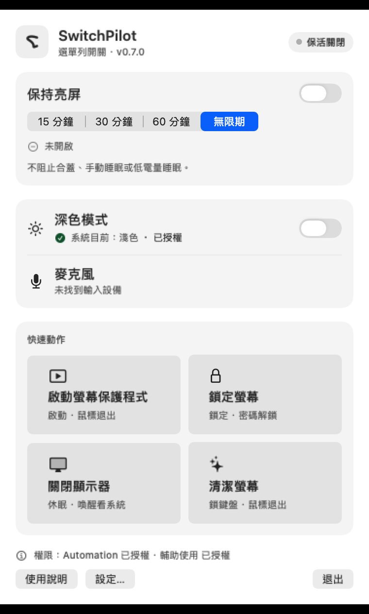
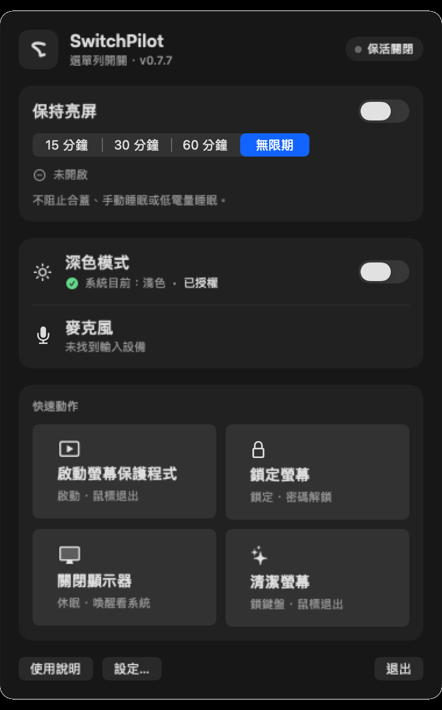
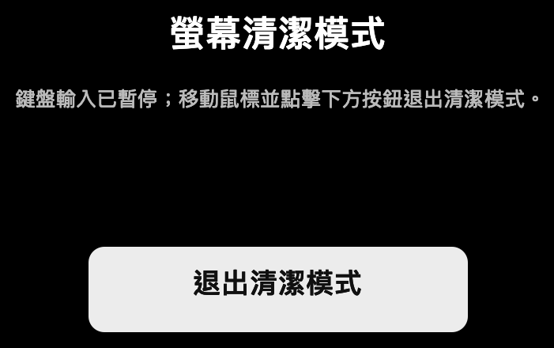

#  SwitchPilot

[English](README.md) · [簡體中文](README.zh-CN.md) · [日本語](README.ja.md) · [文件](docs/README.md) · [核心理念](docs/en/CORE.md) · [架構](docs/en/ARCHITECTURE.md) · [測試](docs/en/TESTING.md) · [路線圖](docs/en/ROADMAP.md)

[](https://github.com/PilotFoundry/switchpilot/actions/workflows/ci.yml)

版本 0.7.1 · 由 PilotFoundry 維護的開源、隱私優先 macOS 選單列工具，只保留少數可靠、低權限的系統控制。

> 本儲存庫保留完整開發歷史，包括早期研究、失敗實驗和現場驗收記錄。應用程式原始碼與目前英文文件位於根目錄；歷史材料在 `artifacts/`、`evidence/`、`tooling/` 等目錄，詳見 [docs/RESEARCH.md](docs/RESEARCH.md)。

<p align="center">
  
  
</p>

## 功能

| 功能 | 行為 |
|---|---|
| 保持亮屏 | 15/30/60 分鐘或無限期，顯示剩餘時間狀態 |
| 深色模式 | 通過 System Events 讀取並切換系統外觀 |
| 啓動螢幕保護程式 | 啓動系統螢幕保護程式程序 |
| 鎖定螢幕 | 發送系統鎖定畫面快速鍵；需要 Automation + 輔助使用 |
| 關閉顯示器 | 調用公開命令 `pmset displaysleepnow` |
| 麥克風靜音 | 按預設輸入設備能力靜音；不支援時誠實提示，不偽造狀態 |
| 螢幕清潔 | 全屏遮罩，暫停鍵盤輸入，鼠標點擊退出，內部保留最後兜底 |
| 登入時啓動 | 可選 `SMAppService` 登入項，由設定控制 |
| 全局快速鍵 | 固定 `⌃⌥⌘K` / `⌃⌥⌘S`，預設關閉 |
| 多語言 | English、簡體中文、繁體中文、日本語；預設跟隨系統，也可在設定中覆蓋並重啓應用程式 |

<p align="center">
  
</p>

## 為什麼做這個專案

SwitchPilot 受 One Switch 將常用系統控制放進選單列這一思路啟發。它是一個刻意保持更小範圍的獨立專案：日常最常用的往往只是少數系統狀態，因此 SwitchPilot 只保留很小的功能面：

- **少而可靠**，而不是 30 個開關的儀錶盤。
- **不用私有 API、不加特權 helper、不做後台自動化。**
- **沒有遙測，也不訪問網路。**
- **權限誠實**：缺少 Automation/輔助使用授權時，相關動作不可用，而不是假裝成功。
- **狀態可見**：麥克風靜音和螢幕清潔會顯示狀態；螢幕清潔鎖鍵盤時保留鼠標退出。

輸出音量、低電量模式、原彩顯示、隱藏桌面、Night Shift、Wi-Fi/藍牙控制、場景自動化明確不在範圍內。准入規則見 [docs/en/CORE.md](docs/en/CORE.md)，目前狀態見 [docs/en/ROADMAP.md](docs/en/ROADMAP.md)。

## 儲存庫標識

README 標記、應用程式圖標和 `assets/social-preview.png` 使用同一個 SwitchPilot 標記。社交預覽圖供儲存庫 owner 在 GitHub 設定中上傳；應用程式圖標仍是視覺源檔案。

## 語言

SwitchPilot 提供四套 UI 本地化：

- English
- 簡體中文
- 繁體中文
- 日本語

預設是**跟隨系統**。設定 → 語言可以強制選擇其中一種；切換後應用程式會提示重新開啟，使 AppKit、SwiftUI 和權限提示的本地化一起重新加載。

## 下載（ad-hoc 預覽版）

[最新 Release](https://github.com/PilotFoundry/switchpilot/releases/latest) 提供由對應 tag 原始碼建置的 universal（Apple Silicon + Intel）macOS 應用。目前專案沒有 Developer ID 憑證，因此它是 **ad-hoc 簽名、未公證** 的版本。

- 需求：macOS 14 或以上
- 檔案：`SwitchPilot-0.7.1-macos-universal-adhoc.zip`
- 下載、解壓縮後把 `SwitchPilot.app` 放到 `/Applications`
- 首次開啟可能被 macOS 阻擋：右鍵點擊應用程式 → **打開**
- 若使用終端機，只對該應用程式執行：
  `xattr -dr com.apple.quarantine /Applications/SwitchPilot.app`
- 不要全域關閉 Gatekeeper

zip 由 `./scripts/build-release` 建置，SHA-256 檔案會隨 release 一起提供（`SwitchPilot-0.7.1-macos-universal-adhoc.zip.sha256`）。這是方便下載的建置，不是 Developer ID／公證發佈；如需完全可信，請自行從原始碼建置並簽名。

## 環境要求

- macOS 14 或更高（主要在 macOS 27 開發測試）
- Swift 6.x
- Apple Command Line Tools 或 Xcode
- 有顯示器的 Mac；螢幕清潔模式還需要輔助使用權限

不需要任何第三方 Swift 依賴。

## 構建與執行

```sh
git clone https://github.com/PilotFoundry/switchpilot.git
cd switchpilot

swift build --package-path app/SwitchPilot --build-system native
./scripts/build-app
./scripts/install-app
open ~/Applications/SwitchPilot.app
```

`scripts/build-app` 組裝 `.app`，預設使用 **ad-hoc 簽名**。ad-hoc 代碼身份會隨二進制變化，重建後 macOS 可能重新詢問權限。如果希望穩定本地身份，可用自己的開發證書：

```sh
SWITCHPILOT_SIGN_IDENTITY="Apple Development: Your Name (TEAMID)" ./scripts/build-app
```

不要提交證書、簽名材料或繞過 Gatekeeper 的配置。應用程式未公證；專案會發佈 universal ad-hoc 便利包，但如需更高信任，請自行從原始碼建置並簽名。詳見 [docs/en/RELEASE.md](docs/en/RELEASE.md)。

### Make targets

```sh
make build   # 構建 Swift package
make app     # 組裝 .app
make release # 建置 universal ad-hoc zip（未公證）
make smoke   # CI 安全構建 + 對比度檢查（不觸發 TCC）
make install # 複製到 ~/Applications
```

## 權限

SwitchPilot 只在你主動使用需要權限的功能時才申請權限。

| 權限 | 用途 | 說明 |
|---|---|---|
| Automation → System Events | 深色模式、鎖定畫面快速鍵 | 這些動作需要 |
| 輔助使用 | 鎖定畫面、螢幕清潔 | 螢幕清潔用它攔截鍵盤事件 |
| 登入項批准 | 登入時啓動 | 通過 `SMAppService` 和系統設定管理 |

應用程式**不會**自行授權、修改 TCC 數據庫、關閉 SIP，也不會自動執行 `tccutil reset`。高級重置面板只在使用者顯式確認後複製命令。撤銷權限請在系統設定中操作。

## 螢幕清潔安全

螢幕清潔不是簡單蓋一層黑窗口：它會通過 session event tap 真正暫停鍵盤事件，同時保留鼠標。點擊螢幕上的**退出清潔模式**按鈕離開；按設計不提供鍵盤退出。

隱藏的五分鐘最後兜底會在鼠標或應用程式狀態失效時釋放會話，正常使用不顯示倒計時。不要在操作者無法使用鼠標時執行該模式。清潔遮罩只影響本地 UI，不修改系統設定。

## 隱私

- 無分析、遙測、崩潰上傳、網路請求或遠程配置。
- 設定只保存在本機 `UserDefaults`。
- 診斷資訊只在你顯式調用時寫入 `/tmp`。
- 不錄製麥克風音頻，只讀寫靜音屬性。
- 不訪問 TCC 數據庫、Keychain、Cookies 或無關檔案。

## 狀態與測試

這是由 PilotFoundry 維護的早期開源專案。部分權限和硬件相關流程需要人工驗收；沒有自動化測試不代表已驗證。CI 在 GitHub macOS runner 上構建應用程式並執行 smoke 檢查，刻意不請求 TCC/TCC 周邊權限。人工驗收矩陣見 [docs/en/TESTING.md](docs/en/TESTING.md)。

## 儲存庫結構

```text
app/SwitchPilot/             Swift package、應用程式和檢查可執行檔案
  Sources/SwitchPilot/       AppKit + SwiftUI 選單列應用程式
  Sources/SwitchPilotCore/   非 UI 系統集成
  Sources/SwitchPilotChecks/ 非 XCTest 核心行為檢查
  Resources/                 應用程式圖標源檔案
docs/                        設計原則、架構、測試、路線圖
docs/images/                 截圖
scripts/                     構建、安裝、smoke 和對比度檢查
```

## 貢獻

歡迎 issue 和 PR。先閱讀 [CONTRIBUTING.md](CONTRIBUTING.md) 和 [CODE_OF_CONDUCT.md](CODE_OF_CONDUCT.md)。產品範圍變更必須通過 CORE 准入規則；小修復不需要先討論功能。

安全報告請使用 GitHub 私有 [security advisory](https://github.com/PilotFoundry/switchpilot/security/advisories) 流程；詳見 [SECURITY.md](SECURITY.md)。

## 許可證

MIT © 2026 pengxianghao。詳見 [LICENSE](LICENSE)。

SwitchPilot 是獨立專案，與 One Switch 無隸屬或背書關係。One Switch 是其各自權利人的產品；本儲存庫不包含 One Switch 代碼、素材或分發二進制。
